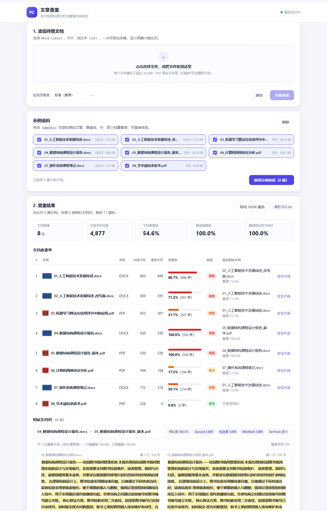

# 文章查重系统（C++ + Web）

一个面向多篇中文短文本的**相似度分析与重复内容检测系统**：后端用纯 C++ 实现（自行解析 DOCX / PDF、自行实现 DEFLATE 解压、指纹与最长公共子串定位），前端为原生 HTML / CSS / JavaScript 的 Web 界面，上传多篇文档即可得到每篇的查重率、等级与**具体的重复位置（行号 + 原文对照）**。

> 课程设计取向：重点在数据结构与算法的实现，不依赖任何大模型或第三方查重服务，也不依赖任何第三方 C/C++ 库。



## 快速开始

- **下载即用**：到 [Releases](https://github.com/ElianKade/paper-check/releases/latest) 下载 `PaperCheck-v0.2.1-win64.zip`，解压后双击 `pc_check.exe`，浏览器访问 <http://127.0.0.1:8080>。压缩包内的 exe 已**静态链接** MinGW 运行库，目标机器无需安装 MinGW、也无需任何第三方 DLL。
- **从源码编译**：安装 MinGW-w64（g++ 支持 C++17）后，在仓库根目录运行 `build.bat`，脚本会自动编译并启动服务。
- **技术文档**：[docs/项目技术文档.docx](docs/项目技术文档.docx)（28 页 Word），逐文件说明后端各模块的功能与所用数据结构、算法，并介绍前后端连接方式、前端结构、实现难点与测试记录。
- **算法文档**：[docs/核心算法原理.docx](docs/核心算法原理.docx)（53 页 Word），按算法名称组织 14 个核心算法，每个算法含原理说明、逐句代码解析表与源码截图。文档目录带超链接，点击可直接跳转到对应算法。

---

## 一、功能特性

| 功能 | 说明 |
| --- | --- |
| 多文档上传查重 | 支持一次上传多篇 `.docx` / `.pdf` / `.txt`，两两比较，至少两篇 |
| 文档解析 | 自行实现 ZIP 解压 + WordprocessingML 解析（DOCX）；自行实现 PDF 对象扫描、Flate 解压、字体编码与 ToUnicode CMap 解析（PDF） |
| 查重率与等级 | 按“重复字符数 / 内容字符数”给出每篇查重率，并映射到 安全 / 警示 / 危险 / 高危 四档 |
| 重复位置定位 | 对每一组相似文档给出**重复片段列表**：两侧行号、匹配字数、上下文与高亮，可直接对照修改 |
| 多维度相似度 | Jaccard、包含度（Containment）、MinHash 估计、SimHash 汉明距离，辅助判断“整篇雷同”还是“局部摘抄” |
| 灵敏度可调 | 标准 / 宽松 / 严格三档，对应最小匹配长度 20 / 12 / 32 个字符 |
| 示例语料 | 内置 `samples/` 8 篇测试文档，覆盖低、中、高三档查重率，一键体验 |
| 报告导出 | 一键导出完整 JSON 报告（含所有片段与指标） |
| 命令行模式 | `--cli` 直接对若干文件查重并打印摘要，便于批量验证 |

---

## 二、查重率判定标准

国内没有统一的查重率合格线，各高校、期刊要求不同。根据公开资料整理的常见参考区间：

- 本科毕业论文：一般要求总文字复制比 **20% ~ 30% 以下**（部分院校放宽到 35%，重点高校收紧至 15%）；
- 硕士学位论文：一般 **10% ~ 20%**；
- 博士学位论文：一般 **5% ~ 10%**（顶尖理工科院校可要求 3% 以内）；
- 多数高校将 30% 以上视为不通过，40% 以上可能进入学术不端审查流程。

参考：[PaperPass 知识库《论文查重率多少算合格》](https://www.paperpass.cn/knowledge/21975.html)。

本系统据此划分四档（可在 `src/analyzer.h` 的 `AnalysisOptions::levelThresholds` 中调整）：

| 等级 | 查重率区间 | 含义 |
| --- | --- | --- |
| 安全 | < 15% | 重复内容少，通常可直接通过常规查重 |
| 警示 | 15% ~ 25% | 接近多数院校警戒线，建议修改重复段落 |
| 危险 | 25% ~ 40% | 明显偏高，需要大幅改写并规范引用 |
| 高危 | ≥ 40% | 存在学术不端风险，须重写重复部分 |

**指标定义**：

```
查重率(文档 i) = 文档 i 中被判定为重复的字符数 / 文档 i 的内容字符数
相似度(文档对) = (查重率(i 相对 j) + 查重率(j 相对 i)) / 2
```

文档级查重率取**多篇重复区间的并集**，同一段文字被多篇文档重复引用时只计一次；`内容字符` 指归一化后参与比对的字符数（中文字符、拉丁字母与数字，忽略空白与标点）。

---

## 三、算法设计

### 3.1 文本提取

- **DOCX**：读取 ZIP 中央目录 → 对 `word/document.xml` 做 DEFLATE 解压 → 用轻量状态机提取 `<w:t>` 文本，按 `<w:p>` / `<w:br>` / `<w:tab>` 处理段落与空白，跳过 `<w:delText>`、`<w:instrText>`（修订与域代码）。
- **PDF**：不依赖 xref 表，直接扫描 `n g obj` 对象；展开对象流（`/ObjStm`）；解码 `FlateDecode` / `ASCIIHexDecode` / `ASCII85Decode`；读取页面树、页面 `/Contents` 与 `/Resources`；解析字体的 `/ToUnicode` CMap（`beginbfchar` / `beginbfrange`）、`/Encoding`（Identity-H、UniGB-UCS2-H、WinAnsi）与 `/Widths`、`/W` 字宽表；解释内容流中的文本算子（`BT/ET`、`Tf`、`Tm`、`Td`、`TD`、`T*`、`TL`、`Tj`、`TJ`、`'`、`"`、`Do`），递归处理 Form XObject；根据文本矩阵与字宽推算笔位，按纵向位移、负向位移、超宽跳变推断换行，按间距补空格。
- **TXT**：按 UTF-8 读取并去掉 BOM。

### 3.2 归一化与位置映射

构造 `NormalizedText`：把原文逐字符归一化（全角转半角、弯引号与破折号统一、ASCII 转小写、仅保留中日韩文字 / 字母 / 数字），同时记录每个归一化字符对应的**原文字节偏移**（`offsets`、`ends`）。这样：

1. 比对在“干净”的字符序列上进行，不受空格、标点、全半角差异干扰；
2. 命中位置可以精确还原为原文片段，并换算成行号（`lineOfOffset`）。

### 3.3 指纹与集合相似度

对归一化字符序列取 k-gram（默认 k = 13），用滚动哈希（FNV-1a 变体，基 1099511628211）把每个 k-gram 映射为 64 位整数，得到文档的 shingle 集合：

- **Jaccard**：`|A ∩ B| / |A ∪ B|`，衡量整体重合程度；
- **包含度**：`|A ∩ B| / min(|A|, |B|)`，衡量“短文档是否被长文档包含”（摘抄检测更敏感）；
- **MinHash**（64 个置换）：用最小哈希签名估计 Jaccard，签名相似度 = 相同位置个数 / 置换数；
- **SimHash**（64 位加权投票）：比较两篇文档的汉明距离，距离越小越相似。

### 3.4 重复片段定位（核心）

1. 对文档 B 建立 `k-gram 哈希 → 出现位置列表` 的倒排索引（每个桶最多保留 24 个候选位置，控制内存）；
2. 顺序扫描文档 A 的每个 k-gram，命中 B 的候选位置后，以该位置为锚点向左右扩展（向左最多 1024 字符），双指针求出**最长公共子串**；
3. 长度 ≥ `minMatch`（默认 20）的匹配记为重复片段；已覆盖区域打标记，长度 ≥ 3k 的匹配整段跳过，避免重复计算；
4. 所有片段按长度降序**贪心选取互不重叠**的片段（每对最多展示 80 段），保证结果可读；
5. 合并重复区间 → 得到每篇文档的重复字符数、查重率，以及每一段的行号与上下文（`contextChars = 24`，超长匹配截断为 320 字）。

### 3.5 复杂度

- 预处理与指纹：`O(n)`；
- 片段定位：平均近似线性（种子命中稀疏），最坏 `O(n·k)`；
- 文档两两比较：`O(m²)`（m 为文档数），实测 8 篇共 4877 字耗时约 13 ms；3 篇 8.5 万字文档耗时约 187 ms。

---

## 四、项目结构

```
文章查重项目（C++）/
├─ src/                     C++ 源码（算法与服务）
│  ├─ common.h/.cpp         UTF-8 ↔ UTF-16、Win32 宽字符文件读写、JSON 转义、计时
│  ├─ inflate.h/.cpp        DEFLATE 解压（自定义 Huffman、LZ77）
│  ├─ zip.h/.cpp            ZIP 容器解析（中央目录、本地头、store/deflate）
│  ├─ docx.h/.cpp           DOCX 正文提取
│  ├─ pdf.h/.cpp            PDF 解析与文本提取（对象、流、字体、CMap、内容流）
│  ├─ text.h/.cpp           文本归一化与原文位置映射
│  ├─ fingerprint.h/.cpp    rolling hash、Jaccard、MinHash、SimHash
│  ├─ similarity.h/.cpp     两两比较、最长公共子串、重复区间与覆盖率
│  ├─ analyzer.h/.cpp       汇总分析、分级、报告 JSON 序列化
│  ├─ http_server.h/.cpp    WinSock2 HTTP 服务（multipart、静态资源）
│  └─ main.cpp              入口：Web 服务模式 / CLI 模式
├─ tools/
│  └─ gen_samples.py        生成 samples/ 测试语料（python-docx + Edge 打印 PDF）
├─ web/                     前端（结构 / 样式 / 脚本分离）
│  ├─ index.html
│  ├─ css/style.css
│  └─ js/app.js
├─ samples/                 8 篇测试文档（DOCX / PDF，覆盖低中高查重率）
├─ docs/                    界面截图、项目技术文档、核心算法原理（Word）
├─ Makefile                 mingw32-make 构建脚本
├─ build.bat                Windows 一键编译并启动
├─ LICENSE                  MIT 许可证
├─ build/                   构建产物（已 gitignore）
└─ README.md
```

---

## 五、编译与运行

### 5.1 环境要求

- Windows 10/11；
- g++（MinGW-w64，支持 C++17）——开发时使用 GCC 15.2.0；
- 无需 CMake、无需任何第三方库（DEFLATE、ZIP、PDF 解析、HTTP 服务均为自行实现）。

### 5.2 编译

一键脚本（自动查找 `g++`、编译并启动服务）：

```bat
build.bat
```

或使用 make：

```bat
mingw32-make
```

或直接调用编译器（Windows 下 g++ 不会自动展开通配符，需逐个列出源文件）：

```bat
g++ -std=c++17 -O2 -Wall -Wextra -Isrc -static -s ^
    src\common.cpp src\inflate.cpp src\zip.cpp src\docx.cpp src\pdf.cpp ^
    src\text.cpp src\fingerprint.cpp src\similarity.cpp src\analyzer.cpp ^
    src\http_server.cpp src\main.cpp ^
    -o build\pc_check.exe -lws2_32
```

> **必须加 `-static`**：MinGW-w64 默认动态链接 `libgcc_s_seh-1.dll`、`libstdc++-6.dll`、`libwinpthread-1.dll`，编译机能运行，但复制到没装 MinGW 的机器会报“找不到 libgcc_s_seh-1.dll”。加上 `-static` 后这些运行库会被打进 exe，复制单个 exe 即可运行；`-s` 只是去掉符号表，让体积更小。`Makefile` 中的 `LDFLAGS ?= -static -s` 与 `build.bat` 已默认启用，无需手动添加。

### 5.3 启动 Web 服务

```bat
build\pc_check.exe --port 8080
```

浏览器打开 <http://127.0.0.1:8080>，选择或拖入文档即可查重；也可以在“示例语料”里勾选 `samples/` 中的文档直接体验。

启动参数：

| 参数 | 说明 |
| --- | --- |
| `--port <端口>` | 监听端口，默认 8080 |
| `--host <地址>` | 监听地址，默认 127.0.0.1 |
| `--web <目录>` | 前端静态资源目录，默认自动查找 `web/` |
| `--samples <目录>` | 示例语料目录，默认自动查找 `samples/` |
| `--cli <文件...>` | 命令行模式，直接查重 |
| `--help` | 打印帮助 |

### 5.4 命令行模式

```bat
build\pc_check.exe --cli samples\01_人工智能技术发展综述.docx samples\02_人工智能技术发展综述_改写版.docx
```

---

## 六、Web API

| 方法 | 路径 | 说明 |
| --- | --- | --- |
| GET | `/api/health` | 服务状态，返回 `{"ok":true,"name":"PaperCheck","version":"1.0"}` |
| GET | `/api/samples` | 列出示例语料目录中的文档 |
| POST | `/api/analyze?minMatch=20&shingleK=13` | 上传查重，`multipart/form-data`，字段名 `files`（可多个） |
| POST | `/api/analyze-samples?minMatch=20` | 示例语料查重，请求体为文件名字符串数组 |

`/api/analyze` 与 `/api/analyze-samples` 返回同一结构：

```jsonc
{
  "ok": true,
  "elapsedMs": 12.8,
  "totalChars": 4877,
  "failures": [],                       // 解析失败的文件及原因
  "documents": [
    {
      "index": 0,
      "name": "01_人工智能技术发展综述.docx",
      "type": "docx",
      "chars": 803,                     // 参与比对的字符数
      "dupChars": 696,                  // 重复字符数（多篇取并集）
      "dupRate": 0.8667,
      "level": 3,                       // 0 安全 / 1 警示 / 2 危险 / 3 高危
      "levelName": "高危",
      "maxPairIndex": 1,
      "maxPairRate": 0.7360,
      "pairIds": [1, 2, 5]
    }
  ],
  "pairs": [
    {
      "id": 1, "a": 0, "b": 1,
      "similarity": 0.7240,
      "rateA": 0.7360, "rateB": 0.7120,
      "jaccard": 0.527, "containment": 0.702,
      "minhash": 0.484, "simhashDistance": 21,
      "dupChars": 591,
      "segments": [
        {
          "aLine": 4, "bLine": 4, "chars": 312,
          "aBefore": "……", "aMatch": "……", "aAfter": "……",
          "bBefore": "……", "bMatch": "……", "bAfter": "……"
        }
      ]
    }
  ]
}
```

`minMatch` 可取值 8~80（默认 20），`shingleK` 可取值 6~30（默认 13）。

---

## 七、测试语料与实测结果

`samples/` 下的 8 篇文档由 `tools/gen_samples.py` 生成：DOCX 用 python-docx 写入，PDF 用 Microsoft Edge 无头模式把 HTML 打印为 PDF（字体子集内嵌 + ToUnicode 映射，正好覆盖本项目 PDF 解析器的主要路径）。语料之间刻意构造了“原文 / 轻度改写 / 段落摘抄 / 完整副本 / 无关文本”等关系。

| 文档 | 类型 | 内容字符 | 重复字符 | 查重率 | 等级 | 与其他文档的关系 |
| --- | --- | ---: | ---: | ---: | --- | --- |
| 01_人工智能技术发展综述.docx | DOCX | 803 | 696 | 86.7% | 高危 | 原文，被 02 改写、被 03 与 07 摘抄 |
| 02_人工智能技术发展综述_改写版.docx | DOCX | 830 | 591 | 71.2% | 高危 | 对 01 的轻度改写 |
| 03_机器学习算法在信用评分中的应用.pdf | PDF | 652 | 207 | 31.7% | 危险 | 摘抄 01 的两个段落 |
| 04_数据结构课程设计报告.docx | DOCX | 530 | 530 | 100% | 高危 | 被 05 完整复制 |
| 05_数据结构课程设计报告_副本.pdf | PDF | 530 | 530 | 100% | 高危 | 04 的 PDF 副本 |
| 06_计算机网络协议分析.pdf | PDF | 594 | 104 | 17.5% | 警示 | 被 07 摘抄一段 |
| 07_操作系统课程笔记.docx | DOCX | 712 | 214 | 30.1% | 危险 | 摘抄 01 与 06 各一段 |
| 08_学术诚信承诺书.pdf | PDF | 226 | 0 | 0% | 安全 | 独立短文本 |

相似文档对（按相似度降序）：

| 文档对 | 相似度 | Jaccard | 包含度 | 重复片段 |
| --- | ---: | ---: | ---: | ---: |
| 04 ↔ 05 | 100% | 1.000 | 1.000 | 1 处 |
| 01 ↔ 02 | 72.4% | 0.527 | 0.702 | 3 处 |
| 01 ↔ 03 | 28.8% | 0.158 | 0.305 | 1 处 |
| 02 ↔ 03 | 28.3% | 0.154 | 0.305 | 1 处 |
| 06 ↔ 07 | 16.1% | 0.077 | 0.158 | 1 处 |
| 01 ↔ 07 | 14.6% | 0.070 | 0.140 | 1 处 |

重新生成语料：

```bat
python tools\gen_samples.py
```

> 说明：`06` 的 17.5% 来自 `07` 对其一段的摘抄——原文与摘抄方都会被判定为“存在重复内容”，这与常见查重系统的口径一致。

---

## 八、已知限制

1. **扫描件 PDF 无法提取文字**：如果 PDF 只有图片层（无文本层），系统会提示“未能从 PDF 中提取到文本（可能是扫描件或图片型 PDF）”，需要先做 OCR。
2. **加密 PDF 不支持**：检测到 `/Encrypt` 时直接提示不支持（尤其是 AES-128/256 加密的 PDF）。
3. **旧版 `.doc` 不支持**：请先另存为 `.docx`。
4. **DOCX 只读正文**：不解析页眉页脚、脚注尾注、批注、文本框与嵌入对象中的文字。
5. **中文未分词**：直接以字符 k-gram 建模，对中文改写（同义替换）不敏感，属于字面查重；对语义级抄袭无法识别（本项目的定位是字面重复检测）。
6. **单次上传上限 200 MB**，超长文档（数十万字）耗时随长度增长。

## 九、后续可改进方向

- 引入中文分词与词级 shingle，提升对同义改写的敏感度；
- 支持 AES 解密与 PDF 增量更新；
- 增加多线程并行比对（文档两两比较天然可并行）；
- 增加“逐句标注”视图与 HTML / PDF 报告导出；
- 支持从 GitHub 批量导入语料与自建语料库检索。

---

## 十、版本记录

| 版本 | 说明 |
| --- | --- |
| v0.1.0 | 首个完整版本：DOCX / PDF 解析、查重算法、Web 前后端、8 篇测试语料、README |
| v0.2.0 | 新增项目技术文档 `docs/项目技术文档.docx`（28 页：模块说明、数据结构与算法、前后端连接、前端结构、难点与测试） |
| v0.2.1 | 修复预编译包在未安装 MinGW 的机器上无法启动的问题：改用 `-static` 静态链接 libgcc / libstdc++ / winpthread，exe 仅依赖系统 DLL |
| v0.3.0 | 新增核心算法文档 `docs/核心算法原理.docx`（53 页：14 个算法、逐句解析、52 张代码截图与示意图、超链接目录） |

## 十一、许可证

本项目基于 [MIT License](LICENSE) 开源，可自由使用、修改与分发。
